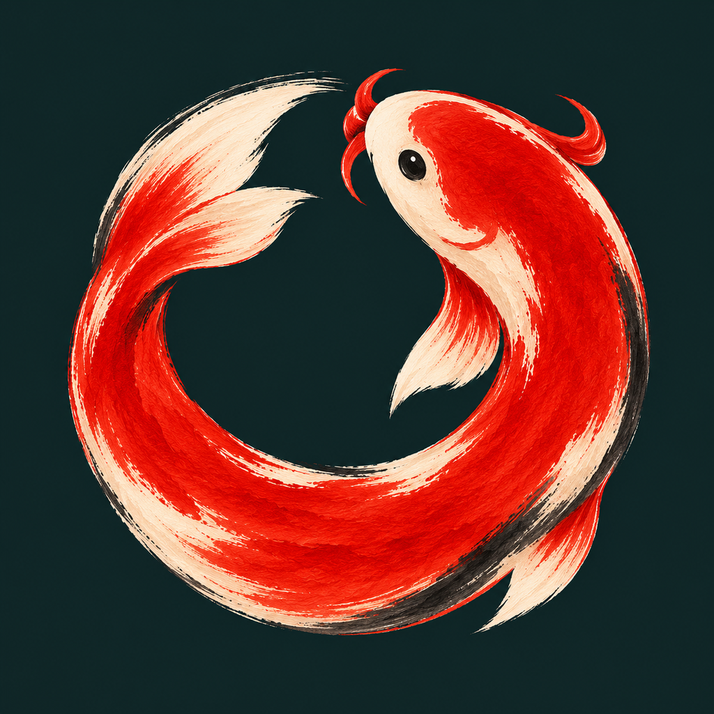
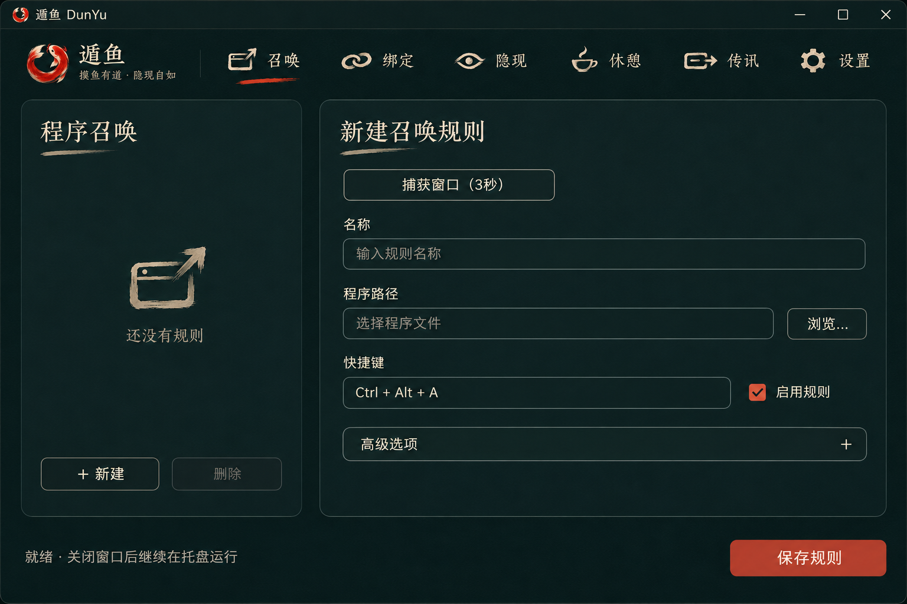
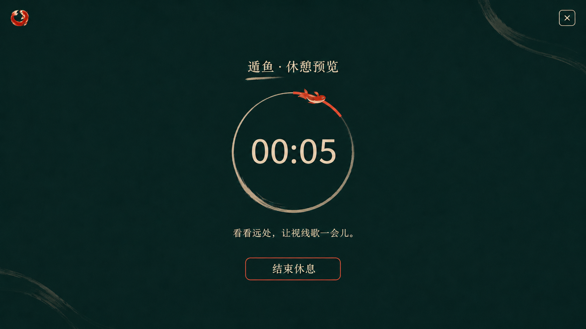
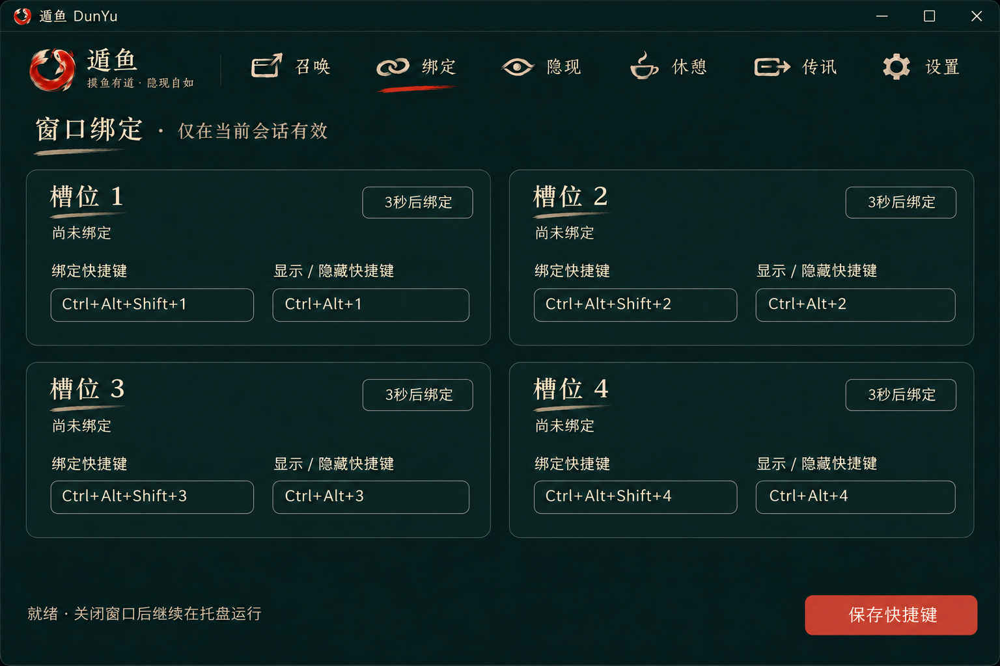
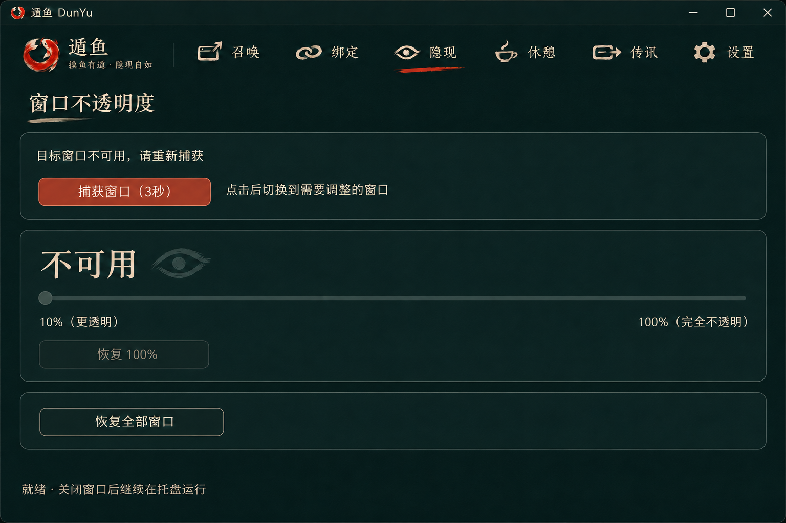
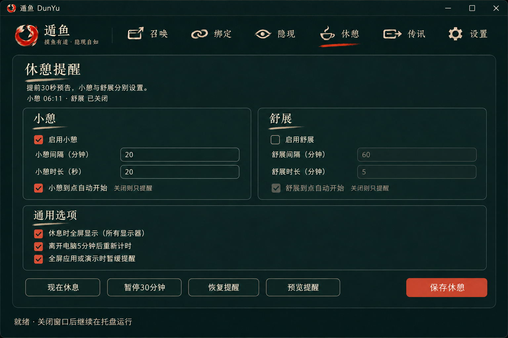
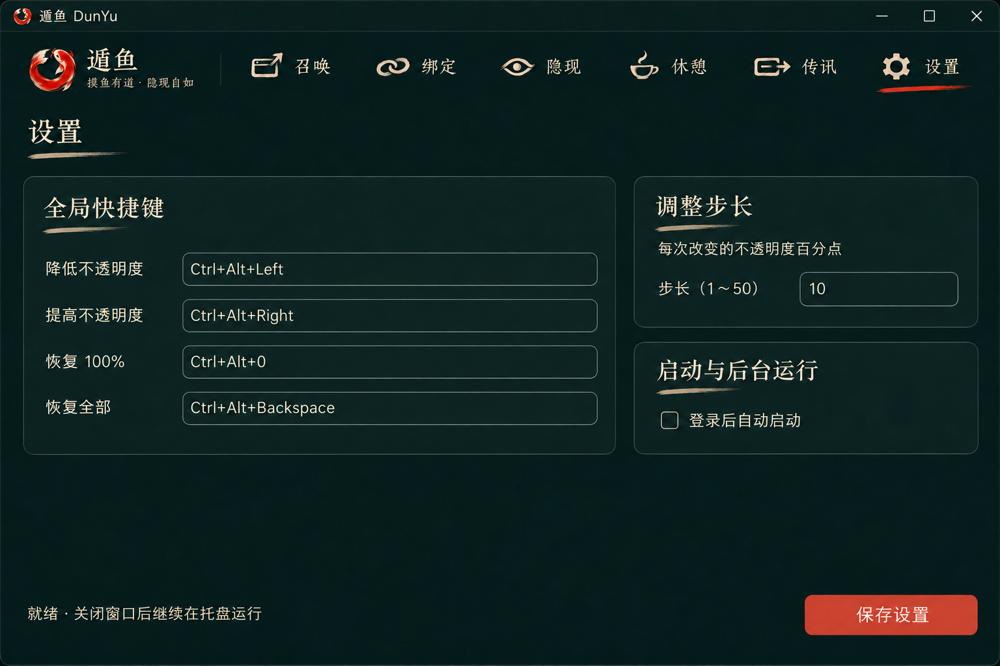

<p align="center">
  
</p>
<h1 align="center">遁鱼 DunYu</h1>
<p align="center"><strong>摸鱼有道 · 隐现自如</strong></p>
<p align="center">一款水墨风 Windows 桌面工具，用快捷键召唤程序、隐现窗口，也提醒自己适时休憩。</p>
<p align="center">
  <a href="https://github.com/dzlzh/DunYu/actions/workflows/ci.yml"></a>
  <br>Windows 10 / 11 x64 · Rust + Win32 · 0.1.0 开发验证版
</p>
<p align="center">
  <a href="#快速开始">快速开始</a> · <a href="docs/USAGE.md">使用说明</a> · <a href="#从源码构建">源码构建</a> · <a href="https://github.com/dzlzh/DunYu/issues">问题反馈</a>
</p>

## 功能

| 页面 | 用途 |
| --- | --- |
| 召唤 | 为程序设置全局快捷键：前台时隐藏，否则恢复并激活，未运行时启动。支持参数和窗口匹配。 |
| 绑定 | 四个临时窗口槽位，快捷绑定、显示和隐藏；绑定仅在当前会话有效。 |
| 隐现 | 调整窗口 10%～100% 不透明度，支持快捷键长按调节和一键恢复。 |
| 休憩 | 小憩与舒展分别设置，支持提前预告、全屏休息、延后、暂停和自然休息识别。 |
| 传讯 | 预留入口，目前为空白页面。 |
| 设置 | 配置全局快捷键、透明度步长及当前用户开机自启动。 |

驻留托盘、单实例运行；配置和受控窗口恢复记录保存在本地。界面支持 DPI 缩放、键盘导航与系统高对比模式。

## 设计预览

以下为本次界面重做的**设计稿**，不是 Windows 实机截图。运行效果及交互仍需实机验收。





<details>
<summary>查看绑定、隐现、休憩与设置设计</summary>






</details>

## 快速开始

1. 打开 [GitHub Actions](https://github.com/dzlzh/DunYu/actions/workflows/ci.yml)，从成功的 Windows 构建下载 `DunYu-windows-x64` 产物，并解压其中的便携 ZIP。
2. 将 `dunyu.exe` 放在可写目录并启动。更新前先从托盘退出旧实例。
3. 在“召唤”页新建规则，选择程序、录入快捷键，点击“保存规则”。也可通过“捕获窗口（3秒）”自动填写目标窗口信息。
4. 关闭主窗口后继续驻留托盘；双击托盘图标重新打开，托盘菜单可恢复窗口或退出。

运行只需 `dunyu.exe`，图标、背景、动画及思源宋体已内嵌；字体许可见 [OFL](resources/fonts/OFL.txt)，便携包附带许可文本。程序旁的 `data` 目录保存用户配置与恢复记录，升级时请保留。

休憩默认关闭。在“休憩”页启用并保存后，默认每 20 分钟小憩 20 秒、每 60 分钟舒展 5 分钟，两种提醒独立设置。可先点击“预览提醒”体验，预览不改变计时计划。

### 默认快捷键

| 操作 | 快捷键 |
| --- | --- |
| 绑定窗口至槽位 1～4 | `Ctrl+Alt+Shift+1～4` |
| 显示／隐藏槽位 1～4 | `Ctrl+Alt+1～4` |
| 降低／提高不透明度 | `Ctrl+Alt+Left` / `Ctrl+Alt+Right` |
| 恢复当前窗口不透明度 | `Ctrl+Alt+0` |
| 恢复全部受控窗口 | `Ctrl+Alt+Backspace` |

程序召唤快捷键由每条规则单独设置。各页修改需要保存；系统保留或已被占用的组合键可能无法注册。适用于普通桌面窗口，权限更高或特殊绘制窗口可能不支持控制。详细操作和排错见 [使用说明](docs/USAGE.md)。

## 从源码构建

需要 **Rust 1.96**。Windows 构建还需要 Visual Studio C++ Build Tools 和 Windows SDK。

```powershell
cargo test --locked --all-targets
cargo build --locked --release
.\target\release\dunyu.exe
```

CI 执行 Linux / Windows 测试，提供 Windows EXE、便携 ZIP、SHA256 校验文件和 `DunYu-ui-preview` 截图产物。截图检查及本地验证步骤见 [使用与验证文档](docs/USAGE.md)。

## 开发状态

当前为开发验证版。已实现窗口控制、快捷键配置、托盘恢复和休憩提醒；水墨界面重做仍需 Windows 10/11 实机验收，重点包括多屏、跨屏 DPI、高对比和键盘操作。

后续规划：传讯功能、配置导入导出、多语言、正式安装包及 Releases 发布。传讯入口目前仅占位，尚不提供通知读取或转发。

## 名称与许可

**遁**，隐匿其形，来去自如；**鱼**，悠游自在，不拘一处。

本项目采用 [GNU General Public License v3.0](LICENSE)（`GPL-3.0-only`）。

内嵌的思源宋体保留其 [SIL Open Font License 1.1](resources/fonts/OFL.txt)，不改变字体原有许可。
